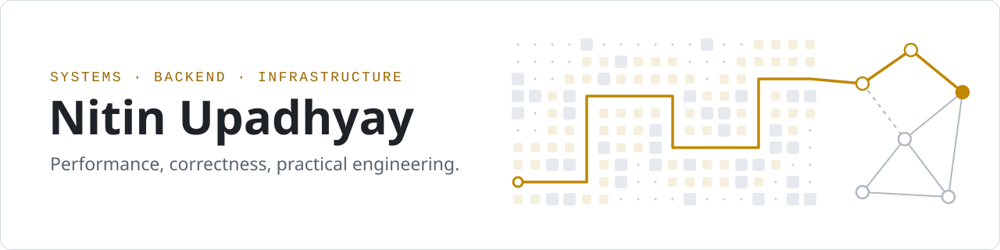

<picture>
  <source media="(prefers-color-scheme: dark)" srcset="assets/banner-dark.svg">
  <source media="(prefers-color-scheme: light)" srcset="assets/banner-light.svg">
  
</picture>

Computer Science student graduating in 2027, focused on systems, backend and infrastructure engineering. I work primarily with C++ and Python on Linux, with an interest in performance, correctness and practical engineering.

### Experience

**Software Engineering Intern** · Centre for Development of Telematics (C-DOT), New Delhi · Jun – Aug 2026 
High-performance networking on Linux, working on a DPDK user-space packet-processing datapath.

### Selected work

<table>
<tr>
<td width="50%" valign="top">

**[Pathfinding Visualizer](https://github.com/Nitin2489/Pathfinding-visualizer)** 
C++17 · CMake

Terminal visualizer and headless benchmark for Dijkstra, A\*, BFS and DFS on seeded, reproducible grids. An independent reference solver checks every timed run. CI builds and tests on Linux, macOS and Windows and includes a sanitizer job. The repository contains a benchmark study of 82,400 timed searches on 2,970 grids, with its raw data, analysis scripts and an audit of the results.
</td>
<td width="50%" valign="top">

**[OrderBridge](https://github.com/Nitin2489/orderbridge)** 
Python · FastAPI · PostgreSQL · Next.js · TypeScript

Ordering and order-desk platform built for an engineering take-home brief, using a simulated FMCG distribution scenario and synthetic data. It has a scheme-pricing engine on the backend that uses decimal arithmetic, row locks and idempotency keys on order confirmation, and OTP sign-in with hashed codes and rate limits. Informal order messages are parsed into lines that a person reviews before any order is created. Tested with pytest against PostgreSQL, Vitest, and Playwright end-to-end tests. [Live demo](https://orderbridge-ten.vercel.app) (synthetic data).
</td>
</tr>
<tr>
<td width="50%" valign="top">

**[RouteSage](https://github.com/Nitin2489/RouteSage)** 
Python · FastAPI · FalkorDB

Network troubleshooting prototype that models routers, interfaces and links as a graph. It evaluates reachability, compares a hypothetical link failure with the current topology (affected router pairs, surviving paths, link-disjoint path count) and stores incident history. An optional LLM explains the graph-verified diagnosis but cannot change network state. It runs on demonstration topology, not live telemetry.
</td>
<td width="50%" valign="top">

**[ChainSense](https://github.com/Nitin2489/chainsense)** 
Python · FastAPI · Solidity · Hardhat

Crowd-sensing prototype that keeps sensor records off-chain, anchors batch Merkle roots on-chain and generates per-record inclusion proofs. It benchmarks per-record, flat-hash and Merkle batch commits. In a local Hardhat experiment with 2,000 synthetic records, Merkle batches of 20 used approximately 95% less gas per record than per-record commits.
</td>
</tr>
</table>

### Currently exploring

`Linux networking` · `C++` · `DPDK` · `system design` · `distributed systems`

### Skills

| Area | Tools | Used in |
|---|---|---|
| Languages | C++17, Python, TypeScript, C, JavaScript, Solidity | C: DPDK internship; others in the projects above |
| Systems and build | Linux, CMake, CTest, GCC/Clang, ASan/UBSan, Docker, GitHub Actions | Pathfinding, OrderBridge |
| Backend and data | FastAPI, SQLAlchemy, Alembic, PostgreSQL, FalkorDB, pytest | OrderBridge, RouteSage, ChainSense |
| Frontend | Next.js, React, Tailwind CSS, Vitest, Playwright | OrderBridge |
| Networking | DPDK, graph-based topology and reachability modelling | Internship, RouteSage |

### Contact

[LinkedIn](https://www.linkedin.com/in/nitinupadhyay438) · [Email](mailto:unitin438@gmail.com)
<!-- TODO(user): add " · [Resume](URL)" once a stable public resume URL exists. -->
